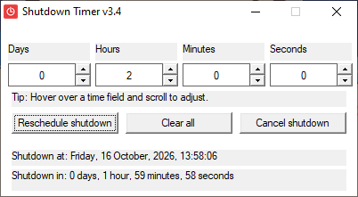

# Shutdown Timer v3.4

- 100% C++, standalone, no dependencies
- persist previous session
- reschedule shutdown (overwrite an ongoing timer)
- Scroll to adjust
- estimated shutdown date and time, plus a labeled countdown

--- 
simply download the .exe in releases and run it

